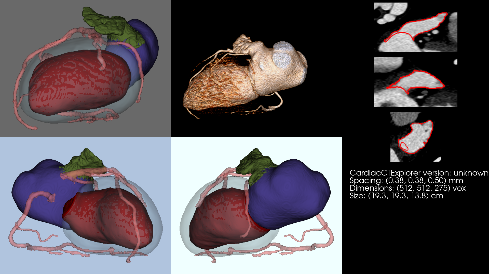

# Cardiac CT Explorer

An open source tool for segmentation of the heart in 3D computed tomography scans with a special focus on the left atrial appendage (LAA).



**Highlights:**

- Based on the excellent work of the [TotalSegmentator](https://github.com/wasserth/TotalSegmentator) team.
- Supports contrast-enhanced cardiac CT scans.
- Creates a segmentation map including the major heart structures, the left atrial appendage and the pulmonary veins.
- Can generate the date described in [STACOM2025: A Public Cardiac CT Dataset Featuring the Left Atrial Appendage](https://github.com/Bjonze/Public-Cardiac-CT-Dataset)
- Has been validated on a series of open source data sets.
- Generates visualizations for easy validation of outputs.
- Designed as a research tool for population studies.

**Note**: This is not a medical device and is not intended for clinical usage. It is meant for research purposes and explorative analysis of the human aorta.

It is based on work done at [DTU Compute](https://www.compute.dtu.dk/), the [Cardiovascular Research Unit, Rigshospitalet, Copenhagen, Denmark](https://www.rigshospitalet.dk/english/research-and-innovation/units-and-groups/Pages/cardiovascular-ct-research-unit.aspx) and [Universitat Pompeu Fabra](https://www.upf.edu/web/enginyeria/faculty/-/asset_publisher/vto8LcELdA46/content/camara-rey-oscar/maximized).

Please cite these papers if you use CardiacCTExplorer:
```bibtex
@inproceedings{juhl2021implicit,
  title={Implicit neural distance representation for unsupervised and supervised classification of complex anatomies},
  author={Juhl, Kristine Aavild and Morales, Xabier and De Backer, Ole and Camara, Oscar and Paulsen, Rasmus R.},
  booktitle={International Conference on Medical Image Computing and Computer-Assisted Intervention},
  pages={405--415},
  year={2021},
  organization={Springer}
}

@inproceedings{Hansen2025LAA,
  title       = {A Public Cardiac CT Dataset Featuring the Left Atrial Appendage},
  author      = {Hansen, Bj{\o}rn and Pedersen, Jonas and Kofoed, Klaus F. and Camara, Oscar and Paulsen, Rasmus R. and S{\o}rensen, Kristine},
  booktitle   = {Statistical Atlases and Computational Modeling of the Heart (STACOM), MICCAI Workshop},
  year        = {2025},
  publisher   = {Springer},
  url         = {https://arxiv.org/abs/2510.06090}
}
```
Please also cite the [TotalSegmentator paper](https://pubs.rsna.org/doi/10.1148/ryai.230024) since CardiacCTExplorer is heavily dependent on it. If you use the ImageCAS data, please cite the [ImageCAS paper](https://www.sciencedirect.com/science/article/pii/S0895611123001052).


## Installation

CardiacCTExplorer has been tested on Ubuntu Linux and Windows but should work on most systems. The GPU usage is limited to the TotalSegmentator segmentation tasks and you can see the requirements [here](https://github.com/wasserth/TotalSegmentator?tab=readme-ov-file).

The installation requires a few steps:

1. Create and activate an environment. e.g a conda environment
```
conda create -n CardiacCTExplorerEnv python=3.13
conda activate CardiacCTExplorerEnv
```

2. Install [PyTorch](https://pytorch.org/get-started/locally/). Choose the cuda version that matches with what you have available for your GPU


3. Install CardiacCTExplorer
```
pip install CardiacCTExplorer
```

3. Install the [TotalSegmentator license](https://github.com/wasserth/TotalSegmentator/blob/master/README.md#subtasks). CardiacCTExplorer is dependent on the `heartchambers_highres`subtask and you need to obtain the [license](https://backend.totalsegmentator.com/license-academic/) and install the license key.


## Usage

CardiacCTExplorer can process:
 - single NIFTI files
 - a folder with NIFTI files
 - a text file with NIFTI file names.
 - single NRRD files
 - a folder with NRRD files
 - a text file with NRRD file names.
 - single DICOM folders
 - folder with DICOM folders
 - a text file with DICOM folder names (full path needed)
 
 
```bash
CardiacCTExplorer -i /data/CardiacCT/CardiacCT_scan.nii.gz -o /data/CardiacCT/CardiacCTExplorerOutput/
```

Will process the NIFTI file `CardiacCT_scan.nii.gz` and create a sub-folder with results in the specified output folder `/data/CardiacCT/CardiacCTExplorerOutput/`.

If the input is a folder, it will process all `.nii.gz` and `.nii` files in that folder. If the input is the name of a text file, it will process all files (specified with full path names) listed in the text file. Note when processing several files, they all need to have unique base names, since the output will named according to this.

**Expected processing time**: CardiacCTExplore is not optimized for speed. On a standard PC (October 2025) the processing time is between 5 and 10 minutes per scan. However, it can process several scans simultanously using multiprocessing and it scales well with the number of cores. 

## Outputs

CardiacCTExplorer main outputs are:
- [CSV file with the aortic measurements](MEASUREMENTS.md). It is called `CardiacCTExplorer_measurements.csv` and will be placed in the specified output folder. One row per input file.
- Visualizations of the results placed in a sub-folder called `all_visualizations`.
- A log file with potential errors and warnings placed in the specified output folder.

If you can not find your expected measurements in the CSV file, you should check the log file to see if there are any reported errors.

**NOTE**: CardiacCTExplorer is not a diagnostic tool and does not check for aortic pathologies like aneurysms. 

## Advanced settings

The CardiacCTExplorer commandline accept a set of arguments:

- `--device`: Choose `cpu` or `gpu` or `gpu:X (e.g., gpu:1 -> cuda:1)` see [TotalSegmentor](https://github.com/wasserth/TotalSegmentator/blob/master/README.md#advanced-settings) for details 
- `--image-x-size` : Visualization image x-side length (default 1920).
- `--image-y-size` : Visualization image y-side length (default 1080).

See [here](CardiacCTexplorer/bin/CardiacCTExplorer.py) for the total set of command line parameters.

## Python API

CardiacCTExplorer can be used as a Python API. For Example:

```Python
from CardiacCTexplorer.python_api import CardiacCTexplorer, get_default_parameters

def test_CardiacCTexplorer():
    params = get_default_parameters()

    input_file = "/data/CardiacCT/CardiacCT_scan.nii.gz"
    output_folder = "/data/CardiacCT/CardiacCTExplorerOutput/"
    device = "gpu"
    verbose = True
    quiet = False

    success = CardiacCTexplorer(input_file, output_folder, params, device=device, verbose=verbose, quiet=quiet)
    assert success, "CardiacCTExplorer failed to run successfully"

if __name__ == "__main__":
    test_CardiacCTexplorer()
```

The `params` is a dictionary, where the individual values can be changed before the call to CardiacCTexplorer. The parameters can be seen [here](CardiacCTexplorer/python_api.py).


## Cardiac segments and measurements

CardiacCTExplorer generates a segmentation map, with the following labels:

## Error handling and pathological cases

AortaExplorer includes a large range of checks for the validity and type of scan. It tries to determine the scan FOV case and only continues on the cases described above. There is also a range of checks on Hounsfield value distributions. If the processing fails, the log file should be inspected for the cause.


### CardiacCTExplorer on ImageCAS


